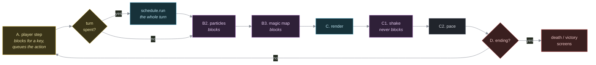

Reference: input handling and the turn loop
============================================

    Audience       Engine developers only. There is no table here, no
                   row to copy — this is the engine itself: the main
                   loop, the keyboard, the modal stack.
    Prerequisites  A passing familiarity with bevy_ecs, and
                   `models/src/meta/components/` for the resources
                   this code reads.
    Status         Describes `engine/src/update.rs`, the main loop in
                   `engine/src/main.rs`, and `turn_schedule` in
                   `models/src/meta/schedule.rs` as they are in the
                   source. If this page and the source disagree, the
                   source is right and this page is a bug.

**This is higher-risk ground than a content table.** A wrong row in the bestiary is a monster with too much HP; a wrong branch here is a keypress that eats a turn it shouldn't, a modal that can't be closed, or a run loop that spins. `update.rs` tests what `dispatch_key` and `dispatch_mouse` decide, but the loops that poll and sleep have no tests, so read the code end to end before you change it, and test by hand: walk into a wall confused, open the pack mid-throw, run a Shift-direction into a monster.

The split this code sits on
----------------------------

`models/` holds the pathfinding and state machines (`autoexplore.rs`, `fastmove.rs`) as **pure functions that only read the world**: no terminal, no sleeping, no turn-taking. `engine/src/update.rs` is the other half: it reads the keyboard, decides when a turn is spent, and drives those pure functions to completion. `engine/src/input.rs` defines the game's own `Event`, and `engine/src/term.rs` is the one file that names crossterm; it drops releases, repeats, resizes and pointer motion before anything else sees them, which is why no handler checks a key's kind.

If you find yourself wanting a `World` query that decides *where* to go, it belongs in `models/`, not here.

The main loop
-------------

    engine/src/main.rs, fn main

`player_step` takes one step from, in order, an `AutoExplore` tick, a `TravelCursor` tick, or a blocking read through `process_input_and_update`, and returns whether a turn was spent. Only then does the schedule run, so monsters act only on a spent turn. A fast-move run is the exception: `fast_move_run` steps the schedule itself, turn by turn, without repainting, so a run reads as one jump. The animations and the shake are `rendering.md`'s.

**The schedule's order is load-bearing.** `turn_schedule` in `models/src/meta/schedule.rs` builds it, and the reasons for its edges live there and in two ADRs:

  * **Everything the player does resolves before `ai`.** The player's step, spell, item use and throw are queued at the key and drained by systems ordered ahead of `ai`, so a zap lands on the tile the player aimed at, not the one the target walked to (`../explanation/adr-0005-aim-resolves-before-the-mobs-move.md`, `../explanation/adr-0008-player-actions-are-queued-intents.md`).
  * **`reveal_mimics` runs before `ai`**, so a xeroc unmasked by the player stepping next to it can lash out the same turn.
  * **`item_system` runs after `spell_system`.** A turn fills only one of their queues, so the edge changes no outcome, but it gives the schedule one order instead of two the executor could choose between.
  * **`throw_system` is not ordered after `trap_system`, on purpose.** A shot that comes down on a trap sets it off through `detonate_at`, inside the throw's own resolution.
  * **A damaging spell only zeroes HP.** `reaper_system` sweeps the body at the end of the turn, so `ai` skips any mob at 0 HP rather than letting a corpse swing.
  * **Monster blows resolve after `ai`.** `ai` fills `AttackQueue` and `combat_system` drains it, dropping a blow whose two sides no longer touch.
  * **`ability_system` runs late**, so a passive that moves the player lands before their next turn, with a visibility pass and a render left to show it.
  * **`score_turn_system` runs last**, so the combo multiplier pays out on the turn's whole pile of kills.

A refusal (not on the stairs, cursed gear, a blocked charge) is logged at the key and spends nothing.

The modal stack
----------------

`process_input_and_update` owns what needs a keyboard: the turns lost with no key read (`player_incapacitated`, `paralysis_forfeits_turn`, neither while a `--MORE--` is pending) and the blocking read itself. Right before that read, `engine::ready::signal_ready` writes the ready signal when `NIHILURK_READY` is set. Everything after the key arrives is `dispatch_key`, a pure state machine over `(world, key)`, which is what makes it testable.

`dispatch_key` takes, in order: Ctrl+C (quits from every context); any other Ctrl chord (dropped); the `--MORE--` gate (only Space or Enter, except that an open offer or barter menu takes its keys first); `x`/`X`, which close whichever modal is open (`close_all_modals`) and otherwise fall through. Then exactly one context owns the key, checked in this order:

| Context                 | Open while               | Handler                  |
|-------------------------|--------------------------|--------------------------|
| Key list (F1), Info     | `HelpMenu`, `ItemInfo`   | any key closes it        |
| "Really quit?"          | `QuitPrompt.open`        | `answer_quit_prompt`     |
| Aiming reticle          | `TargetingState.active`  | `handle_targeting_input` |
| Pack                    | `PackIsOpen.open`        | `handle_inventory_input` |
| Spells list             | `SpellsMenu.open`        | `handle_spells_input`    |
| Offer, barter           | `OfferMenu`, `BarterMenu`| `handle_offer_input`, `handle_barter_input` |
| The map                 | (default)                | `handle_movement_input`  |

They nest one level deep only: the pack can open the reticle, and nothing opens under the reticle or the quit prompt.

Adding a command key
--------------------

A command key is an arm in `handle_movement_input`'s `match`, plus a `PackMode` row if it opens the pack. **Four things claim keys before that `match`, and a command bound to one of their keys never fires:**

  * `run_direction` owns `H J K L Y U B N` (Shift+vi runs), which is why look is `;` and not `L`.
  * The `x`/`X` escape hatch in `dispatch_key`, from every context.
  * Ctrl+C, and the drop of every other Ctrl chord without Alt (Windows reports AltGr as Ctrl+Alt).
  * Alt+`q` `w` `e` `r`, which fire spell slots one to four before the bare letters are read.

Check the menus too: pack and spell rows are lettered from `a`, and their letter arms claim every lowercase key that is not navigation.

**`keymap.txt` remaps only the map and the reticle.** `remap_key` runs at the top of `handle_movement_input` and `handle_targeting_input` and nowhere else, because the menus print `a`-`z` as labels and a remap would make the label lie. `dispatch_key` handles Ctrl+C, `--MORE--` and `x` first, so a bad keymap cannot lock the player in.

**`T` is undocumented on purpose.** It is the willed teleport (`models::queue_willed_teleport`), and every refusal logs nothing, so the key gives no hint it exists. Keep it out of `MANUAL.md`.

`Esc` quits, from the bare map only, through the prompt; every modal takes `Esc` first, so mashing it out of a menu never reaches the prompt.

Pack rows are **backpack indices** everywhere (`PackIsOpen::selected`, `pack_rows`, the drawn letter), which keeps an item's letter the same in every menu.

The walks
---------

Fast move (Shift+direction), auto-explore (`o`) and travel (`>`/`<` to a distant staircase, or the `O` cursor) are thin drivers around planners in `models/`. Fast move runs its whole walk inside `fast_move_run`; auto-explore and travel take one step per `player_step` and go back through the normal render and pace, which is why one jumps and the other visibly walks. Both check `walk_interrupted` before every step and swallow the key that stopped them, so it is not also read as a move.

**`travel_cursor_step` runs its own loop outside `process_input_and_update`**, so the escape hatch never sees its keys. It handles `x`/`X` in its own cancel arm; that arm is the only reason closing it works.

Testing
-------

`update.rs`'s tests cover what `dispatch_key` and `dispatch_mouse` decide: the `--MORE--` gate, the escape hatch, the quit prompt, the keyboard and numpad, Ctrl and function keys, the menus and keymap, the reticle and look, and the mouse. `models/tests/it/creatures/pack.rs` and `models/tests/it/mind/autoexplore.rs` cover what the menus show and where a walk goes. The walking loops and everything the renderer draws are checked by playing.

When you add a branch here, move the *decision* into a pure function (`dispatch_key`, or something in `models/`) and leave `engine/` holding only what must touch the terminal.

See also
--------

  rendering.md                  the other half of the frame: `view.rs`
  ../how-to/work-with-the-ecs.md   adding a system, and the borrow patterns
  ../explanation/ecs-in-nihilurk.md    why the schedule is shaped this way
  ../explanation/agents.md      what `ai` asks each mob to decide
  ../reference/cli-and-env.md   the flags this code reads (`-anim-rate`, `-nshake`)
  ../explanation/code-calisthenics.md   the shape this code (and all engine code) is held to
