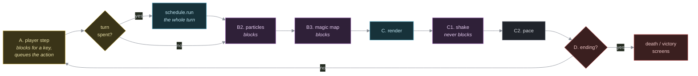
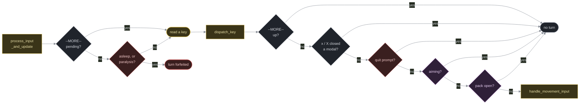
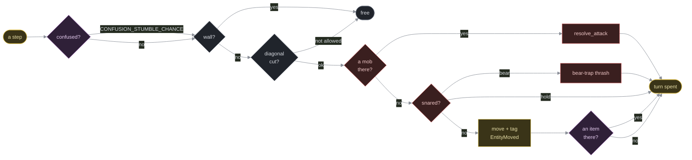

Reference: input handling and the turn loop
============================================

    Audience       Engine developers only. There is no table here, no
                   row to copy — this is the engine itself: the main
                   loop, the keyboard, the modal stack.
    Prerequisites  A passing familiarity with bevy_ecs, and
                   `components.md` for the resources named
                   below (`GameLog`, `PackIsOpen`, `TargetingState`,
                   `AutoExplore`, `FastMove`, `TravelCursor`, `Ending`).
    Status         Describes `engine/src/update.rs` and the main loop
                   in `engine/src/main.rs` as they are in the source.
                   If this page and the source disagree, the source is
                   right and this page is a bug.

**This is higher-risk ground than a content table.** A wrong row in `models/src/monsters.rs` is a monster with too much HP; a wrong branch here is a keypress that eats a turn it shouldn't, a modal that can't be closed, or a run loop that spins. `engine/` carries little test coverage: `update.rs` tests what `dispatch_key` decides and `view.rs` tests the log gate and the help-key remap (see "Testing" below), but the loops that poll and sleep and everything the renderer draws have none — so a mistake there is far more likely to be caught by a person playing the game than by `cargo test`. Change this file by reading it end to end first, and test by hand: walk into a wall confused, open the pack mid-throw, run a Shift-direction into a monster.


The split this code sits on
----------------------------

`models/` holds the pathfinding and state machines (`autoexplore.rs`, `fastmove.rs`) as **pure functions that only read the world** — no terminal, no sleeping, no turn-taking. `engine/src/update.rs` is the other half: it reads the keyboard through `engine/src/input.rs` (the one place that calls `term::read`/`poll`, so a run can be recorded and replayed), decides when a turn is spent, and drives those pure functions to completion. Neither `update.rs` nor `view.rs` names a terminal library: input reaches them as `input.rs`'s own `Event`, and `engine/src/term.rs` is the one file that names crossterm. Nothing in `models/` blocks on input or sleeps; nothing in `engine/` does pathfinding. If you find yourself wanting to add a `World` query that decides *where* to go, it almost certainly belongs in `models/`, not here — see the module doc comments at the top of `autoexplore.rs` and `fastmove.rs`.


The event types
----------------

```
pub enum Event { Key(KeyEvent), Mouse(MouseEvent) }
pub struct KeyEvent { code: KeyCode, modifiers: KeyModifiers }
pub struct MouseEvent { button: MouseButton, column: u16, row: u16, modifiers: KeyModifiers }
pub enum MouseButton { Left, Right }
```

These live in `input.rs` and are the game's own, so `update.rs` matches on them without a terminal library in sight. `KeyCode` has the keys a recording can name (`Char`, `F`, the arrows, `Home`/`End`, `PageUp`/`PageDown`, `Tab`, `BackTab`, `Delete`, `Insert`, `Esc`, `Enter`, `Backspace`). `KeyModifiers` is one byte with Shift 1, Control 2 and Alt 4, the same bits a recording holds; a recording line with any other bit set (Super, say) decodes with that bit dropped.

`term::read` is where the terminal's events become these, and where the filtering happens. Only a key press and a Left or Right mouse down get through: a release, a repeat, a resize, pointer motion, a middle click and a key with no `KeyCode` (Caps Lock, a media key) return `None` and are never logged. That is why no handler in `update.rs` or `view.rs` checks a key's kind. A click comes back in grid coordinates, with the `-c` centering offset of the frame on screen taken off; a click outside the frame is dropped there too.


The main loop
-------------

    engine/src/main.rs, fn main



One `Schedule`, run once per turn, in this fixed order:

    player_action_system -> smoke_system -> tick_effects
      -> reveal_mimics -> spell_system
      -> item_system -> throw_system -> ai -> trap_system
      -> equipment_effects_system -> combat_system -> reaper_system
      -> dungeon_lord_system -> ability_system -> sink_system
      -> visibility_system -> score_turn_system

`ai` keeps the clock, the gates and the hands; what each mob decides to do is its rule set's (`agents.md`). A mob off the player's view does nothing, unless it is aggravated or a Helper.

`reveal_mimics` runs before `ai`: a xeroc's disguise falls away the instant the player is standing next to it, so the same turn that happens, `ai` already sees the plain `Ambush` monster underneath and can lash out. `spell_system` runs before `ai`: an active spell (`Z`, or `Alt`+`Q`/`W`/`E`/`R`) spends its `Magic` cost and resolves before monsters get their response. This matches ordinary movement, which `player_action_system` applies as the schedule's first step. A damaging spell only zeroes its victim's HP — `reaper_system` sweeps the body at the far end of the turn — so `ai` skips any mob already at 0 HP rather than letting a corpse take a parting shot on its way out.

**Everything the player does resolves before `ai` does.** A step, a blow, a lunge or a struggle is planned when the key is handled (`handle_movement_input` → `models::queue_step`) and applied by `player_action_system`, the first step of the schedule (`PlayerActionQueue`). A spell (`SpellQueue`), a used item (`UseQueue`) and a throw (`ThrowQueue`) are drained by `spell_system`, `item_system` and `throw_system`, all of them ahead of `ai`. Taking the stairs (`queue_stairs`), dropping an item (`queue_drop`), a willed teleport (`queue_willed_teleport`), a charge (`queue_charge`) and a reach attack (`queue_reach_attack`) are queued the same way, and wearing or wielding goes through the use queue. A refusal (not on the stairs, cursed gear, a blocked charge) is logged at the key and spends nothing. None of those queues is ever filled by anything but the player, so nothing of the dungeon's own is hurried along by the order. Monster attacks are the other side of it: `ai` fills `AttackQueue` and `combat_system` drains it *after*, which is why that one stays where it is. `combat_system` drops a queued blow whose two sides no longer touch (`still_in_reach`): a trap or a swap since `ai` queued it may have moved one of them, or put the far side of a doorway corner between them.

`item_system` runs before `ai` for the same reason. It also runs after `spell_system`: the two drain different queues and a turn fills at most one, so the edge changes no outcome, but it leaves the schedule with one order instead of two the executor may choose between. A zapped wand is aimed at the dungeon as it stood when the key was pressed; resolved after `ai`, it would read a tile the target had already walked off. The bolt wands would hide it (a bolt sweeps a line, a blast a disc, so they still catch somebody), but every wand that reads one exact tile — teleport away, teleport to, polymorph, haste, slow, cancellation — would report finding nothing there while the reticle sat on the monster. `throw_system` runs before `ai` for the same reason: aimed at the empty tile in front of an approaching orc, the dagger would arrive after the orc had stepped onto it and hit one it was never thrown at. Pinned by `a_zap_lands_on_the_tile_the_player_aimed_at_not_the_one_the_target_left` and `a_throw_lands_where_the_floor_was_when_the_player_let_go` in `update.rs` — which is also why the schedule is built by `turn_schedule()` rather than inline in `main`: a turn order with load-bearing edges needs something able to run it.

One edge is absent on purpose: `throw_system` is not ordered after `trap_system`. A shot that comes down on a trap sets the trap off through `detonate_at`, inside the throw's own resolution, not by waiting for the trap step.

`ability_system` runs late on purpose, after `ai`, `combat_system` and `reaper_system`. A passive that merely happens to you can roll anywhere; one that *moves* you cannot. Rolled after `ai`, a ring of teleportation's jump lands at the top of the player's next turn — they see the new tile and act from it before anything on the floor moves again — and there is still a visibility pass and a render left in the turn to show it to them.

`score_turn_system` is dead last, after `visibility_system`, because it is the one step that must never run early: it totals the turn's kills with the combo multiplier and pays them out in one go, and a multiplier applied to a pile that is still growing is not a number anyone could read.

Each pass through `while world.resource::<GameState>().is_running`:

  1. **Advance the game.** A fast-move run in progress (`FastMove::active`) resolves entirely inside `fast_move_run` — it steps the schedule itself, turn by turn, without repainting. Otherwise, one player step is taken (see `player_step` below); if it consumed a turn, `schedule.run` fires once.
  2. **Play any queued animation.** `view::play_particles` then `view::play_magic_map` — both no-ops unless something armed them this turn. Both **block**: input is frozen for the length of the effect, and a keypress skips to the end and is swallowed. Which is why the `--MORE--` prompt is held back while particles are playing (`log_panel`, in `rendering.md`): a prompt up during an animation asks for the very keypress that skips it.
  3. **Render.** `view::render`.
  4. **Let the screen shake settle.** `view::play_shake`, and this one is the odd step out: it does **not** block. It animates only while nothing is waiting to be read, and the moment a key arrives it settles the map and returns *leaving the key unread* for step 1 of the next pass. That is also what guarantees the map is never left skewed while the loop blocks — the shake either runs out here or is settled here. A no-op unless a turn armed one (and `-nshake` means none ever is); see `rendering.md`, "The screen shake".
  5. **Pace it.** A sleep of `AUTOEXPLORE_STEP_MS` per step while auto-exploring and of `INCAPACITATED_PAUSE_MS` per turn while the player is incapacitated (asleep), both in `engine/src/constants.rs`, so both read as time passing rather than a freeze or a blur.
  6. **Check the ending.** `Ending::player_dead` or `player_won` breaks the loop into the death or victory screens.

```
fn player_step(world: &mut World) -> std::io::Result<bool>
```

One player-side step, in priority order: an `AutoExplore` tick, else a `TravelCursor` tick, else a blocking read of the player's own move via `process_input_and_update`. Returns whether a turn was spent — the main loop only runs the schedule (lets monsters act) when this is `true`.


The modal stack
----------------



```
pub fn process_input_and_update(world: &mut World) -> std::io::Result<bool>
pub(crate) fn dispatch_key(world: &mut World, key: KeyEvent) -> std::io::Result<bool>
```

The split between the two is the line between "needs a keyboard" and "does not". `process_input_and_update` owns the three things that can consume a frame with no key read at all, and the blocking `read()`; everything after that key arrives is `dispatch_key`, which is a pure state machine over `(world, key)` and is tested as one — see "Testing" below.

Before reading a key at all, two things can consume the turn without one, and neither fires while a `--MORE--` prompt is pending (that prompt needs a key, see below): `player_incapacitated` (asleep — in gas, or in a scroll of sleep that turned in your own mouth: the turn is forfeited outright with no key read; a bear trap or a scroll's hold does *not* forfeit the turn, since either only blocks movement, not the whole turn — see "Movement and attack" below), and `paralysis_forfeits_turn` (a potion of paralysis: the coin is flipped **once per turn**, here, before any key is read and never while a menu, prompt or reticle is open, so a lost turn is a turn the monsters get and the player does not, rather than a swallowed keystroke; a forfeited one holds the screen `INCAPACITATED_PAUSE_MS` so it reads as time passing).

Right before that read, `engine::ready::signal_ready` writes the ready signal when `NIHILURK_READY` is set (`cli-and-env.md`), so a script driving the game knows it now waits on a key. `travel_cursor_step` and `wait_for_key` (the death and victory screens) do the same before theirs. The reads that only let a key skip an animation or stop a walk (`drain_input`, `interrupted`, the shake, `walk_interrupted`) do not: the game is not waiting there.

Once a key is read, `dispatch_key` takes Ctrl+C, drops any other Ctrl chord, and holds the `--MORE--` gate: while messages wait, only Space/Enter does anything, and it acknowledges them. An open offer or barter menu is the one exception and takes its keys ahead of the gate (`an_open_offer_takes_the_keys_ahead_of_a_pending_more`). Then `x` and `X`, in every context: they are the universal escape hatch, closing whichever modal is open (`close_all_modals`, the quit prompt included) and returning to plain movement with no turn spent. On the bare map `close_all_modals` reports nothing to close, so `x` falls through to the weapon swap and `X` does nothing. After that, exactly one of these contexts owns the keypress:

| Context (checked in this order) | Resource      | Handler                    |
|----------------------------------|---------------|-----------------------------|
| Key list (F1)                    | `HelpMenu.open` | `dispatch_key` itself: any key closes it, nothing else runs |
| Item Info popup                  | `ItemInfo.open` | `dispatch_key` itself: any key closes it, nothing else runs |
| "Really quit?"                   | `QuitPrompt.open` | `answer_quit_prompt`   |
| Aiming (a throw or a ranged use)| `TargetingState.active` | `handle_targeting_input` |
| Pack open                        | `PackIsOpen.open` | `handle_inventory_input` |
| Spells list (`Z`)                | `SpellsMenu.open` | `handle_spells_input`    |
| A spirit's offer                | `OfferMenu.open` | `handle_offer_input`     |
| A demon's barter                | `BarterMenu.open` | `handle_barter_input`    |
| Walking the map                  | (default)     | `handle_movement_input`    |

They nest one level deep only: the pack can open the aiming reticle (`Throw`, or a `Use` that needs a target), but the reticle itself has no modal under it. The quit prompt is raised only from the map, so it never has anything under it either — it is first in the list because while it is up, that question is the only one on the table. `y` quits, `n` / `Esc` cancels (and so do `x` / `X`, upstream), every other key is ignored rather than guessed at.


Movement and attack
--------------------



```
fn queue_step(world: &mut World, dx: i16, dy: i16) -> bool
```

The single path every step and every melee attack goes through (auto-explore, fast-move and the plain arrow keys all call this). It calls `models::plan_step`, which decides what the step will do and changes nothing but the confusion roll, and queues the result as a `PlayerAction::Step`. It returns whether the turn is spent, the caller's cue to run the schedule; `player_action_system` then does the stepping. Checked in order, each one able to end the attempt:

  0. **Paralysis** — not checked here at all: a potion of paralysis eats its turns upstream, in `process_input_and_update`,. By the time a step reaches `queue_step` the turn is the player's to spend.
  1. **Confusion stumble** (`maybe_stumble`) — while `Confused`, a coin flip hijacks the step into one of the eight `STUMBLE_DIRS` at random, logging "You stumble foolishly." A stumble into a wall still burns the turn; a deliberate wall-bump does not.
  1.5. **An estoc's lunge** (`models::try_lunge`) — checked before the wall/diagonal gates below, since it targets the tile *past* the one those gates would otherwise judge. Self-checks `Lunges` (lent to the wielder while an estoc is in hand) and the geometry: the near tile (`new_x, new_y`) open and unoccupied, a `Mob` on the tile past it in the same direction. If both hold, it resolves a guaranteed triple-damage strike (`combat::resolve_lunge`) and carries the player into the near tile itself, tagging `EntityMoved` — a full alternate ending to the function, never falling through to steps 2+. A no-op, returning `false`, for anyone not wielding one.
  2. **Wall.** `Map::walkable`, which lets a player who `Swims` into deep water.
  3. **Diagonal cut.** `Map::diagonal_step_ok` — a diagonal step must connect two tiles of the same kind, so you can't cut a doorway corner or squeeze from a corridor into a room diagonally.
  4. **A `Mob` on the target tile** — attacks instead of moving (`models::melee_attack`, which resolves the plain opposed-roll swing via `resolve_attack` plus whatever a wielded weapon lends on top of it — an estoc's second strike, a battle axe's cleave onto every other adjacent monster — each self-checked against the weapon's own marker, so this call site never has to know either trick exists). An `IceCube` is the other exception: the player kicks it (`models::kick_ice_cube`) — it homes on the `auto_fight_target` for cold damage, or flies off the way it was kicked, and shatters either way, spending the turn. An ally (`Faction::Ally`, the player's `Helper` among them) is the last exception: walking into it is a step, and the two trade places at step 6.
  4.5. **Momentum resets** (`models::reset_momentum`) — reached only when step 4 did *not* fire: a rapier's built-up `Momentum` is done the moment its wielder does anything but keep swinging it.
  5. **Something holding the player** (`Pinned`, `Clamped`, `Rooted`, checked by `player_held_by`) — an adjacent swing above still lands as an attack (step 4), but a plain step does not. A bear trap makes it `bear_trap_thrash`: a wasted turn, a scratch of damage, blood. Jaws (a venus flytrap's bite, a revealed xeroc's) make it `clamped_thrash`, the same lurch in other words. Roots cost the turn and a line, nothing else. `../how-to/add-a-trap.md` has the bear trap itself.
  6. **The move.** Position updates, the player's `Viewshed` is marked dirty, and `EntityMoved` is tagged on the player so `trap_system` checks the new tile. A `Helper` the player walked into takes the tile they left, tagged `EntityMoved` too.
  6.5. **A chain-sickle's whirl** (`models::try_whirl_attack`) — self-checks `WhirlOnMove` and looks for a monster adjacent to *both* the tile just left and the tile just reached (a step taken alongside an enemy), landing a free `melee_attack` on it if one qualifies.
  7. **Pickup.** An `Item` on the landed tile is stowed (`models::stow`) — which can merge into an existing quiver stack, leave part of a pile behind if the pack is full, or refuse outright ("Your pack is full."). A `Hidden` (invisibly stashed) item announces itself the instant it's stepped on.

Steps 1.5–5 can each end the attempt early. Only a refusal at step 2 or 3 is free (`StepPlan::spends_turn`): a lunge, a kick, a swing, a held thrash and the move all spend the turn, and so does a stumble into a wall. Every weapon trick above lives in `models::combat`/`models::abilities`, self-checking the marker it answers to — `plan_step` never mentions `Fencer`, `Cleaves` or `WhirlOnMove` by name, the same way it never mentions a ring.

A greatclub's own trick (`HeavySwing`) doesn't live here at all: it fires as an on-hit ability inside `resolve_attack` itself (staggering the victim one turn, `Asleep`), and sets `ExtraMonsterRound`, a resource `models::ai::ai` checks on its next run to hand the floor one extra monster round on top of whatever the player's own tempo already bought.

A reach weapon's own strike (a bardiche, a whip) does not go through `queue_step` at all — `v` opens the aiming reticle instead (see "The aiming reticle" below) and queues the strike (`models::queue_reach_attack`) for `player_action_system` to resolve through `models::resolve_reach_attack`.


The keyboard on the map
------------------------

**`keymap.txt` remaps keys here.** `remap_key` (`update.rs`) runs at the top of `handle_movement_input` and `handle_targeting_input` and nothing else. The menus read `a`-`z` as the labels they print, so a remap there would make the label lie. `dispatch_key` handles Ctrl+C, `--MORE--` and the `x` escape hatch before either handler, so a bad keymap cannot lock the player in. The `KeyMap` resource is `models::KeyMap`.

Movement is vi keys, arrows and the numpad, eight ways, plus Shift+direction to run (`run_direction`). **WASD is not a movement scheme**, shifted or bare: `a`, `d`, `w` and `W` are commands.

**`Esc` quits, from the bare map only.** Every modal takes `Esc` first, so mashing it out of a menu never reaches the prompt. Quitting is `Esc` through the prompt, or Ctrl+C without one. `Q` and `X` do not quit.

| Key | `handle_movement_input` does |
|-----|------------------------------|
| `i` `a` `t` `d` `e` `q` `r` `z` `w` `W` `P` | `open_pack(world, PackMode::…)` — see below |
| `o` / `O` | auto-explore / travel cursor |
| `A` | `toggle_auto_pickup` — flips `AutoPickup::enabled`, logs which way it landed, spends no turn |
| `f` / `Tab` | fire the wielded launcher / auto-fight; with a `Returns` weapon in hand (`models::wielded_returner`), both throw it instead (`aim_returner` / `ranged_auto_fight`) |
| `v` | `begin_reach_attack` — gated on `models::wielded_reach_weapon`, opens the aiming reticle out to the weapon's own `Reach` (`TargetingState.reach_attack`); a wielded `Returns` weapon opens a throw reticle instead (`aim_returner`) |
| `T` | **undocumented on purpose.** `models::queue_willed_teleport`, applied by `models::willed_teleport`: with `Teleportitis` on the player (a worn ring of teleportation) and at least `rings::TELEPORT_MAGIC_COST` magic points, it spends them and jumps. Every other path returns `false` and **logs nothing at all** — no refusal, no hint the key exists. Keep it out of `MANUAL.md`. |
| `;` | `begin_look` — opens the reticle in look mode (see below). Not `L`: that is the shifted vi key for east and `run_direction` claims it first |
| `Z` | `begin_spells_menu` — the spells list, rows lettered `a`-`d`. The slower way to an active spell. |
| `Alt`+`Q` `W` `E` `R` | `fire_spell(world, slot)` for slots one to four, checked before the bare letters so `Alt`+`q` casts while `q` still quaffs. Any other `Alt`-held key does what it does bare. `Shift`+digit was rejected for these: it is layout-dependent |
| `>` `.` / `<` `,` | stairs, or travel to them |
| `F1` | open `HelpMenu`, the key list. No turn |
| `F2` | toggle `CommandBar.hidden`, the yellow bar. No turn |
| `x` | `models::queue_swap_weapon` — wields the next known, uncursed `Slot::Hand` item in pack order across the melee/`Launcher` divide, as `PlayerAction::SwapWeapon` (one turn). Refuses, with a log line and no turn, when there is no such item or a cursed weapon is in hand. Reached only with nothing open; otherwise it is the escape hatch above |
| `Esc` | raise `QuitPrompt` — the "Really quit?" modal. With time stopped it takes two yeses; the main loop saves only on `save_on_time_edge`, never while time is stopped, and skips the exit save then too |
| Ctrl+C | **never reaches this table.** `dispatch_key` claims it first, above the `--MORE--` gate, so it quits from every context — a menu that selects rows by letter would otherwise read it as picking row `c` |

Adding a command key is a row in that `match` and (if it opens the pack) a row in `PackMode`. Four things claim keys before that `match` runs, and a command bound to one of their keys never fires:

  * **`run_direction`**, called at the top of `handle_movement_input`, owns `H J K L Y U B N` outright. A command on any of those eight is dead code, which is why look is `;` (`semicolon_looks_and_shift_l_still_runs`).
  * **the `x`/`X` escape hatch** in `dispatch_key`, which fires from every context including the map.
  * **Ctrl+C**, taken at the very top of `dispatch_key`, above everything. Right after it, any other key held with Ctrl and without Alt is dropped, so no command can be bound to a Ctrl chord by accident (Windows reports AltGr as Ctrl+Alt, which is why Alt exempts a key).
  * **Alt+`q` `w` `e` `r`**, in `handle_movement_input` before the bare letters, so those four keys mean two things depending on Alt. Terminals deliver Alt as Esc plus the letter, and crossterm calls it Alt only when both bytes arrive in one read.

Check a new key against the menus' own letters too: pack rows run from `a` for `PACK_CAPACITY` rows and spells rows from `a` for `SPELLSET_CAP`, and both menus' letter arms claim every lowercase key that isn't already navigation. In a menu, navigation is read before the letter, so `j` and `k` can never select a row.


The pack and the action modal
-------------------------------

Eleven keys open the pack, each in a `PackMode` (`models/src/pack.rs`) that decides the title, which rows are shown (`pack_rows`) and what picking one does (`PackMode::action`). `i` is the only one that asks afterwards; the rest carry their own verb and commit on the spot, closing the pack as they go. `open_pack` refuses with the mode's own line ("You have nothing to read.") rather than opening an empty box.

Rows are **backpack indices**, not row numbers, everywhere — `PackIsOpen::selected`, `pack_rows`, `commit_item_action`'s `item_idx`, and the letter `draw_inventory` paints. That is what keeps an item's letter the same in every menu; `step_row` walks the cursor between the admitted indices, skipping the rest.

The action modal (`run_action_modal`, `PackMode::Browse` only) is a fixed four-row menu — `ItemAction::MENU` — that dispatches to `commit_item_action`:

| `ItemAction` | What happens | Spends a turn? |
|--------------|--------------|-----------------|
| `Use`        | `use_or_aim`: a plain item queues onto `UseQueue` immediately; a ranged one (has `Ranged`, and isn't a self-targeted wand like light) instead reopens the aiming reticle; a treat or ammunition goes back in the pack with a "for throwing" line (`models::use_refusal`). | Only the immediate case |
| `Throw`      | `aim_throw`: opens the aiming reticle, unless `throw_refusal` objects (the Element of Yoord, cursed worn gear). | Never here — the throw itself is queued from the reticle |
| `Drop`       | `queue_drop`: refused by `drop_refusal` (cursed and equipped) with the item left in the pack; otherwise queued, and `player_action_system` unequips it and places it on the floor. | Yes, on success |
| `Info`       | Fills `ItemInfo` from `models::item_info` and opens its popup (`draw_item_info`); any key closes it. The text is the name, the dice and reach its components carry, `strings::item_blurb(id)` if the row has an authored line, and — only when `known_quality` — the enchantment plus and `strings::cursed_explained`. Add a blurb as an arm in `item_blurb`. | Never |

`pack_item` reads the item at a pack row. Nothing leaves the `Backpack` at the key, not even while the reticle is up: the queued intent names the item where it sits, and its system lifts it.


The aiming reticle
--------------------

The reticle opens on the closest visible monster within its own reach (`nearest_mob`, ties broken in reading order), so one monster and one wand is `z`, pick, `Enter` with no cursor keys in between; with nothing in view it opens on the player. Look mode opens on the nearest thing `Tab` could reach, a monster or an item (`look_opens_on_the_closest_thing_in_view`), and on the player when there is none. Its cursor *is* your attention: `meet_its_eyes` fires `OnTargeted` on opening and on every move, so a look that opens on a medusa meets its gaze.

`TargetingState` holds which of an item, an active spell, a plain look, or a reach weapon's own strike the reticle is for (exactly one of `item` / `spell_effect` / `looking` / `reach_attack` is meaningfully set — `reach_attack` is the one exception that still carries `item`, since the weapon never leaves the wielder's hand), plus whether it's a throw, and the cursor. `spell_target_cursor` only allows the cursor onto a tile that is both currently visible and within `aim_range` — for a throw, whatever `models::throw_reach` says: `LAUNCHER_RANGE` for ammunition matched to the launcher in hand, `LIGHT_THROW_RANGE` for a potion, scroll, wand or ring, `THROW_RANGE` for everything heavier; the spell's own `SpellDef.range`, the wielded weapon's own `Reach` for a reach attack, the item's own `Ranged.range` for a zap, a look's own reach the width of the map (the `in_view` check does the real bounding), `8` as a fallback. `Tab` (`cycle_target`) snaps the cursor to the next monster or item in view instead of nudging it one tile. Confirming (`fire_at_target`) refuses a shot at the player's own tile ("Great idea! But no.") for every purpose except looking — that one is allowed on your own tile, and spends no turn at all. A reach attack queues the strike (`models::queue_reach_attack`) for `player_action_system`, and never touches the pack; otherwise it calls `models::queue_throw`, `queue_use` or `queue_cast`, which push a `WantsToThrow`, `WantsToUse` or `WantsToCast` for `throw_system` / `item_system` / `spell_system` to resolve next schedule run. The item stays in the pack until its system lifts it. A throw of a stacked item (arrows) goes through `models::draw_one` there, which splits one unit off and leaves the rest in the pack slot.

`;` opens the reticle in look mode; every cursor move (arrows or `Tab`) reads the tile out loud through `announce_look` rather than waiting for `Enter` — `;` then `Tab Tab Tab` walks everything in view. `?` on the look reticle, like a look click, opens the Info popup on everything on the tile (`open_tile_info`): each thing's name and `models::tile_info` (an item's Info lines, a creature's health, attack, defence and speed, plus the hits each side needs to kill the other from `mean_blow`, and what a trap does), then what a creature has on. Bare floor opens nothing. On a monster, it also logs one line, `"Beware: flying; spellcasting."`, listing each notable ability, immunity or on-hit trick it carries. Bare floor logs nothing. The phrases come from `models::dangers_of`, which reads the `beware` field off each `EFFECTS` row, plus the creature's spellbook and launcher — the engine crate names no markers of its own. Every creature is a *they*, whatever it is.


Running, auto-explore, and travel
-----------------------------------

Three engine-owned loops replace a single `process_input_and_update` call while they're active; each is a thin driver around a pure planner in `models/` (`fastmove.rs`, `autoexplore.rs`):

| Loop | Armed by | Resource | Planner | Stops on |
|------|----------|----------|---------|----------|
| Fast move ("run") | Shift+direction | `FastMove` | `fast_move_plan`, then `travel_step`/`straight_step` each step | keypress, a monster in view, a message logged, junction/target reached, `FAST_MOVE_STEP_CAP` |
| Auto-explore | `o` | `AutoExplore` (`target: None`) | `explore_step` | the same, with `AUTO_EXPLORE_STEP_CAP` for the cap, plus "nowhere left to explore" |
| Travel | `>`/`<` to a known but distant staircase, or the `O` cursor | `AutoExplore` (`target: Some(tile)`) | `travel_step` | same, plus arrival |
| Travel cursor | `O` | `TravelCursor` | (none — it's just a cursor; `<` `>` `m`/`M` `i`/`I` jump) | Esc/`O`/`x`/`X`, or Enter to commit into a travel `AutoExplore` |

`explore_step` heads for the nearest goal every step: a frontier tile, or a spotted item it judges worth the walk (see `known_item_tiles`), ranked together by path length in one `nearest_open_tile` search, with ties going toward the still-unseen downstairs. It remembers no destination between steps, so a player who moves nearer another goal goes there. The step's own pickup on arrival (`models::pick_up_here`, step 7 above) does the stowing.

`detours_for_loot` is what can call the beeline off wholesale, and it is the `A` toggle (`AutoPickup::enabled`) and nothing else. Whether a *particular* item is worth walking to is asked item by item, in `known_item_tiles` → `worth_the_walk`: a coin the player cannot use yet is skipped (its row's `helps`), and so is anything needing a pack slot once the pack is at `PACK_CAPACITY`. That per-item gate is not politeness — without it, a full pack walks to an item, is halted by "Your pack is full.", and beelines to the same item on the next `o`, so the floor never gets explored. A coin needs no slot, which is why a full pack no longer calls the whole detour off.

The player can also turn an item down, and `worth_the_walk` skips what they have (`LeftBehind`, a transient resource like `AutoExplore`, never saved): an item they dropped (`apply_drop` → `leave_behind`), and an item they spotted in a room and walked out of without (`apply_step` → `note_room_step`). A room is the room floor 4-connected to the player's tile. A doorway or water counts as neither in nor out, so a step into the doorway and back turns nothing down. A step `o` took itself turns nothing down either: the walk passing an item on its way to a nearer frontier has not refused it. Picking an item up (`take_back`) and a new floor (`forget_left_behind`, from `transition_level`) clear it.

Fast move (`fast_move_run`) is the odd one out: it runs its entire walk **inside one call**, stepping `schedule.run` itself between moves and never repainting until it returns, so a run reads as a single jump rather than an animated walk. Auto-explore and travel instead take one step per `player_step` call (`auto_explore_step`), returning to the main loop's normal render-and-pace cycle after each — which is why auto-explore visibly walks while a run visibly jumps.

**Starting a walk.** All three refuse to *start* with a monster in sight. The run and auto-explore also refuse while confused; travel (`>`/`<`, `O`) does not check. A Shift run from a body with `Charges` (nihil) toward a creature in the pressed direction's wedge becomes a charge instead (`models::queue_charge`, applied by `models::charge`): one turn, the player lands beside the creature, strikes, and is `Vuln` for the monster phase that follows. With a foe already adjacent it refuses (`FastMovePlan::ThickOfIt`).

Both `auto_explore_step` and `fast_move_run` check pending input before every step through `walk_interrupted`, stopping on the first event and swallowing it, so it is not also read as a move on the next frame. Only a key press or a Left or Right click gets that far (see "The event types" above), so a right click's own release cannot cut short the travel it started.

**Mouse** (`-mouse` only; capture is off otherwise). `process_input_and_update` and `travel_cursor_step` both pass an `Event::Mouse` to `dispatch_mouse`, which maps the grid cell to a tile with `tile_under` (`MAP_TOP` removed; `term::read` took the centering offset off already). Left = look (`describe_target` + `open_tile_info` + `meet_its_eyes`; no turn unless a gaze answers it), or move the reticle / `O` cursor. Right = travel (`O` cursor's commit via `confirm_travel_cursor`), or on the reticle move then `fire_at_target`. Unseen tiles, menus and `--MORE--` ignore it. Tests: `update.rs`, "The mouse".

`travel_cursor_step` is different again: it isn't a walk at all, just a blinking highlight the player steers with arrow/vi/numpad keys over already-`revealed` ground (sliding along one axis when the diagonal neighbour is still unseen), gated to `TRAVEL_BLINK_MS` polls so the blink phase flips on a timeout. It runs its own loop outside `process_input_and_update`, so the universal escape hatch never sees its keys — `x` / `X` are handled in its own cancel arm instead, which is the only reason closing it works at all. Enter or Space commits the tile to a travel `AutoExplore`, through `nearest_reachable` when the chosen tile isn't itself walkable.


Testing
-------

`engine/src/update.rs` carries a `#[cfg(test)] mod tests`, and it covers what `dispatch_key` and `dispatch_mouse` decide — none of which needs a terminal, because none of it is downstream of `read()`:

  * **The `--MORE--` gate.** No key but Space/Enter does anything while messages are waiting; acknowledging drops *exactly* the messages the panel showed, not all of them and not one; and the gate outranks the escape hatch, so a player mashing `x` cannot lose the line telling them why they are about to die.
  * **The `x` / `X` escape hatch.** Either closes whichever modal is open. A bare `x` on the map is not swallowed: it swaps weapons.
  * **The quit prompt.** `y` / `n`; every other key ignored rather than guessed at; it outranks a movement key; `Esc` closes one, and raises one from the bare map.
  * **The keyboard.** A numpad digit moves identically to its vi-key equivalent, and Shift+numpad reads as a run direction like Shift+arrow.
  * **Ctrl and the function keys.** Ctrl+C quits from every context, a pending `--MORE--` included; any other Ctrl chord does nothing; `F1` and `F2` spend no turn.
  * **The menus.** The spells list picks a slot by letter and never by digit; `Alt`+`Q`/`W`/`E`/`R` fire slots one to four; a `keymap.txt` remap walks like the key it stands for, and menus keep their literal keys.
  * **The reticle and look.** Where the reticle opens, which targets `Tab` skips, what `?` opens on a pile and in what order, and the tile a zap or a throw lands on.
  * **The mouse.** A cell maps to the tile under it; left looks, right travels; a click on an unseen tile or under a menu does nothing.
  * **Time stop and replay.** The save on each time-stop edge, the second yes to quit inside one, and that one seed and one key list play out the same run.

`view.rs` has no tests of what a frame looks like, on purpose — see `rendering.md`. It pins only the log gate and the help-key remap. What is exercised only by playing the game: everything the renderer draws, and the run / travel / auto-explore loops (they poll and sleep). The reticle's opening target and the tile a zap or throw lands on are tested in `update.rs`; its cursor loop is not. What *can* be tested is also tested one level down, in `models/`: `tests/it/pack.rs` pins what each menu shows, and `tests/it/autoexplore.rs` pins which goal the walk picks and what it leaves behind.

When you add a branch here, prefer moving the *decision* (what should happen) into a pure function — `dispatch_key`, or something in `models/` — and leave `engine/` holding only the parts that must touch the terminal.


See also
--------

  rendering.md                  the other half of the frame: `view.rs`
  ../how-to/work-with-the-ecs.md   adding a system, and the borrow patterns
  ../explanation/ecs-in-nihilurk.md    why the schedule is shaped this way
  ../explanation/adr-0005-aim-resolves-before-the-mobs-move.md  why aiming systems sit ahead of `ai`
  ../reference/components.md    the resources named throughout this page
  ../reference/cli-and-env.md   the flags this code reads (`-anim-rate`, `-nshake`)
  ../explanation/code-calisthenics.md   the shape this code (and all engine code) is held to
