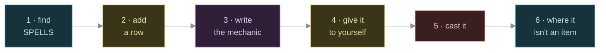

Tutorial: add your first spell
==============================

    Audience       Anyone who wants to add content to nihilurk. You have
                   done `add-your-first-item.md`, or you are
                   comfortable enough to skip it.
    Prerequisites  A checkout, and a working `cargo`. That is all.
    Time           About ten minutes.
    You will       Add an active spell, aim it, feel it cost Magic,
                   then see where the pattern stops looking like an
                   item.

This is a lesson, not a recipe. When you want the short version, read `../how-to/add-a-spell.md`.

What you are about to learn
----------------------------

nihilurk teaches its active spells to the player in play, at random through a hero coin (an uncommon coin-table pickup) or by a spirit's offer; only the lurk starts with one, Bide. A spell is coded the way a potion or a wand is -- one catalog row naming the one function that does it -- because it is exactly as *active* as either of those. This tutorial adds one more, by hand, the way every spell in the table was first tried.

It is also, on purpose, not an item. It has no `Position`, no `Item` marker, no pack slot. It cannot be dropped, thrown, or found on a floor. It lives permanently in whoever's `Spellset` it's in, and it spends Magic instead of a battery.

By the end you will have added Ice Bolt, and you will know exactly which parts of "add an item" still apply and which ones stopped applying the moment you left `Position` off the struct.

Step 1: find the table
------------------------

Every spell is a row in `SPELLS`, in:

    models/src/catalog.rs

Search for it:

    pub static SPELLS: &[&SpellDef] = &[
        // ...
        // The fire blast a dragon breathes, and the player casts.
        &SpellDef::new("Fireball", 2, spells::breathe_fire).attack().aimed(8).bursts(BLAST_RADIUS).wasted_on(wands::fireproof),
        // ... more rows ...
    ];

Like every catalog row, Fireball has no name of its own in Rust. The dragon's bestiary row reaches it through `SPELLS[FIREBALL]`, where `FIREBALL` is an `index_of!` const the compiler works out from the row's name.

`"Fireball"` is the spell's identity: a save stores it. `2` is the `cost` in Magic points, spent by `spell_system` the instant the spell actually fires (multiplied by a wielded staff's `TurboMagic`, but only for an attack). `spells::breathe_fire` is the function that does it. `.attack()` makes it an attack, the staff's business. `.aimed(8)` opens the aiming reticle and lets it reach eight tiles, exactly the way a wand's `Ranged.range` does -- you will aim Ice Bolt the same way you'd zap a wand of cold. `.bursts(..)` is the disc the reticle paints, and `.wasted_on(..)` lets the reticle skip a creature that fire cannot hurt.

Step 2: add a row
-------------------

Ice Bolt is Fireball's cold twin. Add a row anywhere in `SPELLS`:

    &SpellDef::new("Ice Bolt", 2, spells::ice_bolt).attack().aimed(6).bursts(BLAST_RADIUS),

Build:

    cargo build

It will not compile. That is the point of the next step -- unlike a weapon or a suit of armour, a spell's row is not the whole of it.

Step 3: write the mechanic
-----------------------------

The error names `spells::ice_bolt`, which does not exist yet. Every spell's function lives in `models/src/items/spells.rs` and takes the same two things: the world and a `SpellCast`, which says who cast it, where it was aimed, and `power_mult`. That is `constants::spells::TURBO_MAGIC_POWER_MULT` when a staff multiplied an attack's cost, `1` otherwise -- fold it into your damage the way every existing attack does. The staff gives back more damage than it takes in Magic; both multipliers live in `constants::spells`, one beside the other, so the trade stays readable.

A row has to name a function, so a spell that silently does nothing cannot build. Write it next to `breathe_fire`:

    pub(crate) fn ice_bolt(world: &mut World, cast: SpellCast) {
        let SpellCast {
            user,
            target,
            power_mult,
            ..
        } = cast;
        let (power, power_bonus) = {
            let fighter = world.get::<Fighter>(user);
            let loadout = loadout(world, user);
            (
                fighter.map_or(0, |f| f.power) + loadout.power_die,
                fighter.map_or(0, |f| f.power_bonus) + loadout.power_bonus,
            )
        };
        let damage = ((world
            .resource_mut::<GameRng>()
            .0
            .gen_range(1..=power.max(1))
            + power_bonus)
            .max(0))
            * power_mult;
        world
            .resource_mut::<GameLog>()
            .add("A wave of killing frost radiates outward!".to_string());
        elemental_blast(
            world,
            Some(user),
            target,
            BLAST_RADIUS,
            damage,
            Some(Element::Cold),
            BlastPalette::Frost,
        );
    }

The log line is a string literal so the lesson stays on one page; a sentence the player reads belongs in `strings/src/en.rs`, the way `breathe_fire`'s does.

Look closely and you'll notice you wrote almost nothing. `elemental_blast` is the same function a zapped wand of cold calls -- the disc, the line-of-sight check, the animation, the chain reaction into any trap or coin caught in it, all of it borrowed. The only thing `ice_bolt` supplies is *how much damage*, computed from the caster's own claws rather than a wand's dice. That computation is copied verbatim from `breathe_fire` right above it; a spell that inflicts a status instead of damage would instead borrow from `crate::conditions`, the way a wand's utility effects do.

Build again:

    cargo build

It compiles.

Step 4: give it to yourself
------------------------------

There is no `NIHILURK_SPAWN` for a spell -- there is no entity to spawn. In play, the only way to learn one is a hero coin (an uncommon coin-table pickup that teaches a random not-yet-known spell); to try Ice Bolt without hunting for a coin, replace the empty `Spellset::default()` in `initialize_world` (`models/src/map/levels.rs`) with:

    Spellset {
        slots: vec![spell_row("Ice Bolt").unwrap()],
    },

and add `spell_row` to the `use crate::catalog::{...}` line at the top of `levels.rs`.

Tests about the lurk, the hero coin and amnesia expect the starting `Spellset` the game really gives, so `cargo test` fails while this edit stands. Step 7 reverts it.

Build and run:

    cargo build
    cargo run -p nihilurk

Step 5: cast it
------------------

Press `Z`. You should see a small box listing Ice Bolt and its Magic cost. Press `a` (or confirm the highlighted row) to pick it, and the aiming reticle opens exactly as it would for a wand.

Rows are lettered `a` to `d`, the way the pack's are. `Alt`+`Q`, `W`, `E` and `R` fire slots one to four straight from the map, without the menu. While the reticle is up, `Tab` snaps it to the next monster or item in view instead of nudging it one tile at a time.

Confirm the shot at something, and watch your Magic drop by two. Cast it once more to empty the pool. If the first bolt froze your target, the reticle opens on you, and the game refuses a blast on your own tile: move the cursor off yourself first. Then try a third time: the reticle never even opens, and the log says why.

Step 6: where it stops being an item
----------------------------------------

Try the things that work on a potion, a wand, a dagger:

  * **Open the pack (`i`) and look for Ice Bolt.** It isn't there. A spell never enters a `Backpack`; the player's copy of it lives only in `Spellset`.
  * **Try to throw it (`t`).** There is nothing to select -- the throw menu only ever lists `Backpack` contents, and a spell was never in one.
  * **Save and reload.** Your Magic total survives, and so does your `Spellset` -- `models/src/saveload.rs` stores each spell by its row's name. If Ice Bolt ever left a marker of its own lying around on you (the way the spell Magic Ward or Bide does), that marker would need a row in the `EFFECTS` registry and an `effects::lend` to put it there -- see `../how-to/add-a-spell.md` for the two that already do.
  * **Give a monster the same trick.** A spell's function is a shared *mechanic* -- `ice_bolt` doesn't care who `user` is -- and a monster casts from its spellset out of its own `Magic`. Reach Ice Bolt through an `index_of!` const (`const ICE_BOLT: usize = index_of!(SPELLS, "Ice Bolt");`), put `SPELLS[ICE_BOLT]` in a static list the way `BREATHES_FIRE` holds `SPELLS[FIREBALL]` in `models/src/monsters.rs`, and chain `.casts(3, &THAT_LIST)` on a bestiary row, and that creature is born with the spell and the Ma for three casts of it, and its rule set will pick it and fire it at you until the Ma runs out. The dragon's Fireball is exactly that. See `../reference/agents.md`.

None of that is a bug in what you built. It's the shape of the thing: a spell is a mechanic on loan to whoever's `Spellset` names it, not a possession with a life of its own on the floor.

Step 7: keep it or drop it
------------------------------

Either way, put the starting `Spellset` back, so `cargo test` passes again:

    git checkout models/src/map/levels.rs

If you like Ice Bolt, leave the row and its function. If this was a dry run:

    git checkout models/src/catalog.rs models/src/items/spells.rs \
                 models/src/map/levels.rs

What you actually learned
----------------------------

  * A spell is built the same way a potion or a wand is: one catalog row that names the function doing it, so a row cannot ship silent.

  * Almost all of a spell's behaviour is borrowed from whatever already does the thing -- `elemental_blast` for a blast, `crate::conditions` for a status -- the same reuse a wand's own mechanic leans on.

  * A spell is *not* an item, deliberately: no `Position`, no `Item`, no pack slot, no `NIHILURK_SPAWN`, nothing to throw or drop. It lives in a `Spellset`, and it costs Magic instead of running out of charges.

  * A spell's mechanic is shared and reusable — a monster can do the same trick, as the dragon does. `.casts(...)` on a bestiary row gives it the spell and the Magic to pay for it, and its rule set does the triggering.

Where to go next
-------------------

  ../how-to/add-a-spell.md                 the short version, as a recipe
  add-your-first-item.md                  the same lesson, for items
  ../how-to/add-an-item.md                the pattern this one borrows
  ../reference/input-and-turn-loop.md     where `spell_system` sits in the schedule
